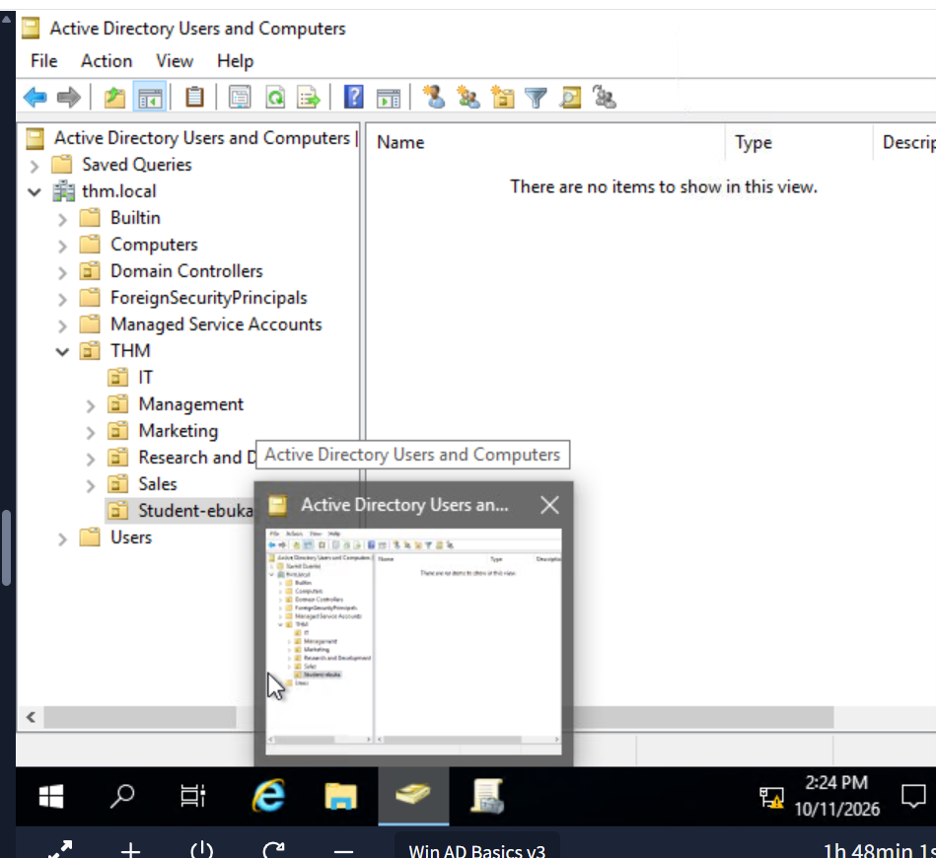
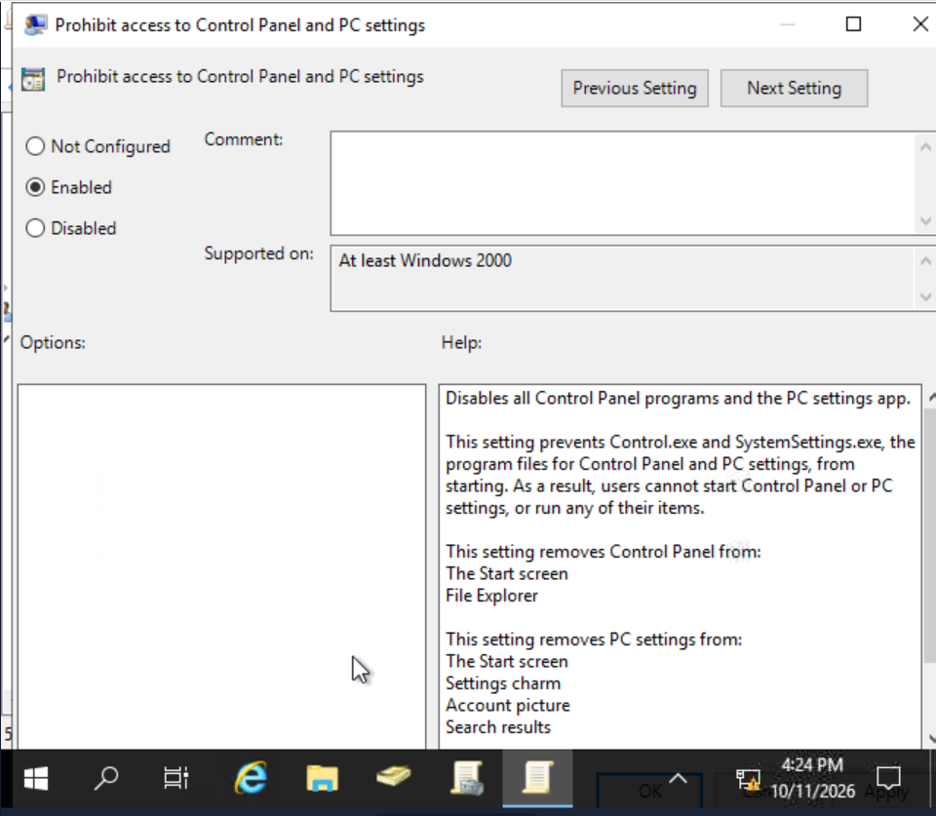
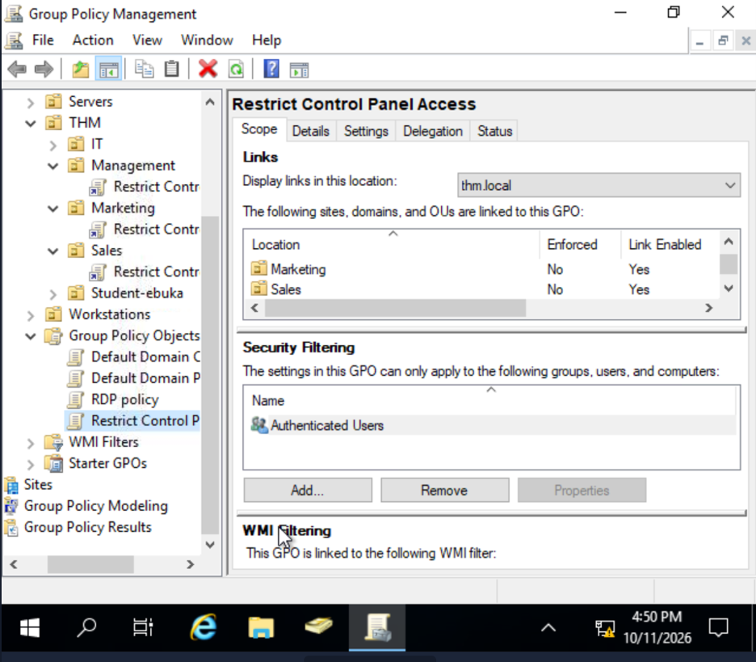
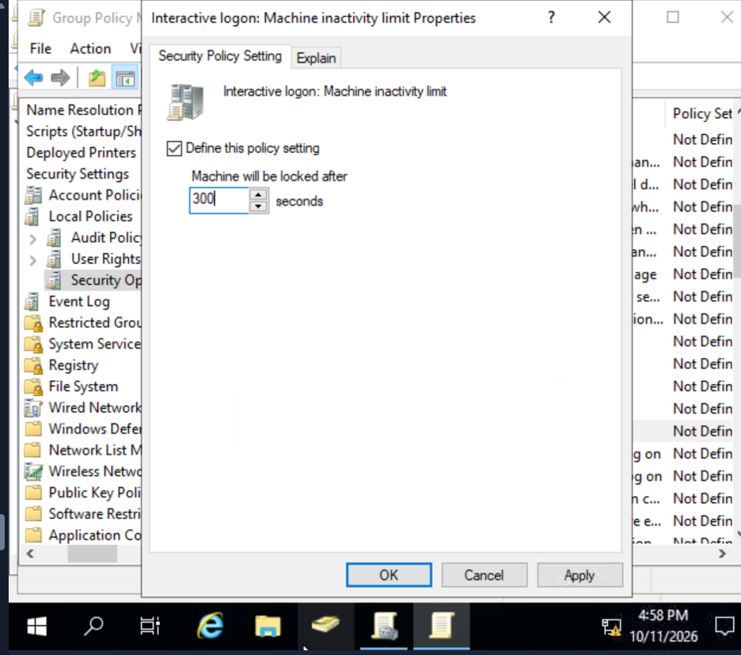
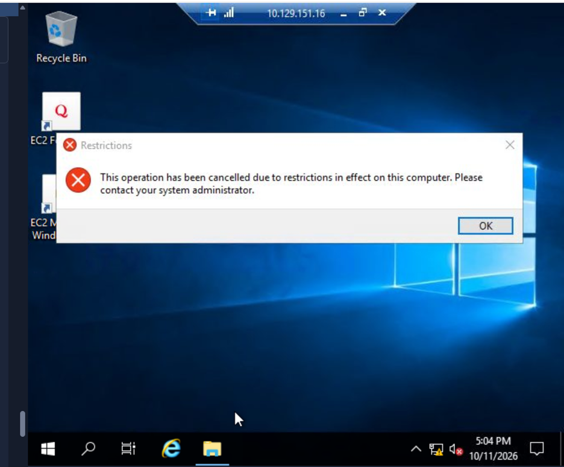

# Windows & Active Directory Fundamentals

**Platform:** TryHackMe – Cyber Security 101  
**Modules:** Windows Fundamentals (Parts 1–3) and Active Directory Basics  
**Status:** Completed

## Overview

Completed hands-on exercises covering Windows administration, system monitoring, command-line diagnostics, Active Directory management, delegated administration and Group Policy security controls.

## Technical Skills Practised

| Area | Tools / Features | Practical Application |
|---|---|---|
| Windows Administration | Computer Management, System Configuration, `msinfo32` | Inspecting system information and administrative settings |
| System Monitoring | Task Manager, Resource Monitor | Reviewing processes, CPU, memory and network activity |
| Task Automation | Task Scheduler | Creating a scheduled task to launch Command Prompt |
| Command Line | `hostname`, `whoami`, `ipconfig /all`, `netstat`, `net` | Inspecting system identity, user context and network connections |
| Event Monitoring | Event Viewer | Reviewing Windows system and application events |
| Endpoint Security | Windows Security, Firewall, Windows Update | Exploring built-in security controls |
| Active Directory | AD Users and Computers | Managing domain computer objects and organisational structure |
| Organisational Units | OUs | Organising computers and servers for administration and policy targeting |
| Delegated Administration | AD delegation | Practising limited administrative permissions for IT support |
| Group Policy | Group Policy Management | Configuring and linking security restrictions |
| Authentication | Kerberos, NTLM | Understanding Windows domain authentication concepts |

## Practical Exercise – Active Directory Administration

### Domain Organisation

Worked within the `thm.local` training domain using Active Directory Users and Computers.

- Examined the domain structure and organisational units.
- Organised computer objects into appropriate administrative locations.
- Practised separating workstations and servers.
- Explored the difference between organisational units and security groups.
- Completed a delegated administration exercise involving an IT support user.

### Group Policy – Control Panel Restriction

Configured a Group Policy Object to restrict Control Panel and Windows Settings access for targeted non-IT users.

- Enabled the **Prohibit access to Control Panel and PC settings** policy.
- Reviewed the GPO's organisational-unit links.
- Tested the restriction on a Windows workstation.

**Result:** Windows displayed a restriction message when access was attempted, demonstrating that the policy was taking effect.

### Group Policy – Automatic Screen Lock

Configured the **Interactive logon: Machine inactivity limit** security setting to **300 seconds (5 minutes)**.

This control is intended to reduce the risk of unattended sessions remaining accessible.

## Evidence

### Active Directory Computer Management

### Control Panel Restriction Configuration

### Group Policy Links

### Automatic Screen Lock Configuration

### Control Panel Restriction – Test Result

## Security & Enterprise Relevance

These exercises strengthened my understanding of how Windows environments are administered and secured centrally.

The Active Directory exercises demonstrated the importance of organisational structure, delegated administration and consistent security policies across managed systems.

The Group Policy exercises reinforced the importance of testing a security control after configuration rather than assuming it works simply because it has been enabled.

## Key Takeaway

Gained practical experience navigating Windows administrative tools, inspecting system activity, working with Active Directory computer objects, configuring Group Policy settings and validating an endpoint restriction in a simulated enterprise environment.
