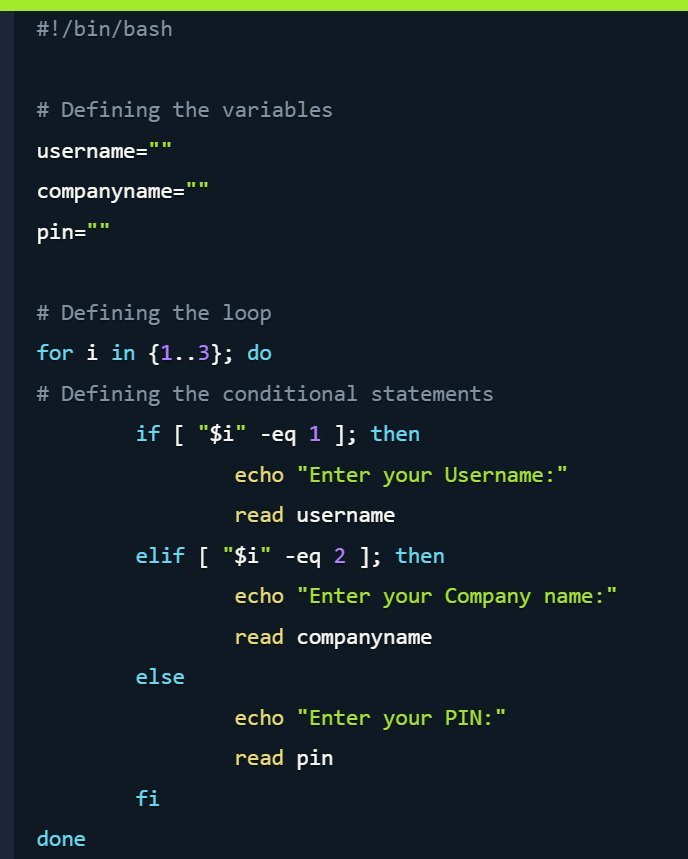
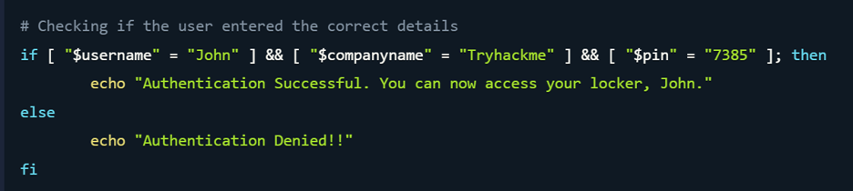
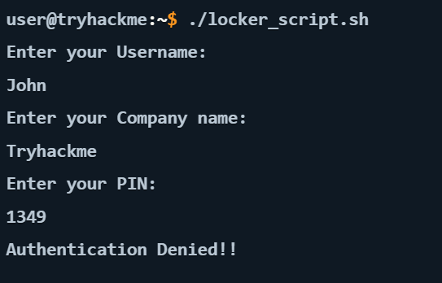

# Command Line Fundamentals — TryHackMe

**Platform:** TryHackMe  
**Learning Path:** Cyber Security 101  
**Rooms Completed:** Windows Command Line, Windows PowerShell and Linux Shell

## Overview

This module strengthened my understanding of command-line interfaces across Windows and Linux environments.

Through three practical rooms, I explored system administration, file management, network troubleshooting, system information gathering and basic shell scripting.

I also gained a better understanding of how command-line tools can support everyday IT operations, security investigations and troubleshooting.

## 1. Windows Command Line (CMD)

In the Windows Command Line room, I practised using `cmd.exe` to interact with the operating system without relying on the graphical interface.

### Commands Practised

| Command | Purpose |
|---|---|
| `ver` | Display the Windows version |
| `cd` | Navigate between directories |
| `dir` | List files and directories |
| `copy` | Copy files |
| `type` | Display the contents of a text file |
| `ipconfig /all` | View detailed network adapter configuration |
| `ping` | Test network connectivity |
| `tracert` | Trace the route to a destination |
| `netstat` | Inspect network connections and listening ports |
| `systeminfo` | Retrieve operating system and hardware information |
| `shutdown /s` | Shut down the system |
| `shutdown /r` | Restart the system |
| `/?` | Display command help and available options |

### Skills Developed

- Navigating the Windows file system through the terminal.
- Retrieving operating system and network configuration information.
- Using network utilities to support connectivity troubleshooting.
- Exploring command options through built-in help.

**Key takeaway:** CMD provides a useful foundation for Windows troubleshooting and administrative tasks, particularly when a graphical interface is unavailable or unnecessary.

## 2. Windows PowerShell

The PowerShell room introduced me to a more powerful command-line environment for Windows administration.

I practised using PowerShell cmdlets to retrieve system information, explore files and directories, inspect services and work with networking information.

### Commands and Concepts Explored

| Cmdlet | Purpose |
|---|---|
| `Get-Location` | Display the current working directory |
| `Get-ChildItem` | List files and directories |
| `Get-Service` | Inspect Windows services |
| `Get-Alias` | Discover command aliases |
| `Get-NetIPConfiguration` | Retrieve network configuration |
| `Get-FileHash` | Calculate a file hash |
| `Invoke-Command` | Execute commands through PowerShell's command invocation capabilities |

### Practical Learning

One particularly useful discovery was `Get-Alias`, which helped me understand how familiar command shortcuts relate to PowerShell cmdlets.

I also explored basic PowerShell scripting and completed an additional practical challenge during the room.

### Skills Developed

- Navigating and inspecting the Windows environment using PowerShell.
- Retrieving service and networking information.
- Understanding cmdlets and command aliases.
- Exploring file hashing and its relevance to integrity verification.
- Developing familiarity with PowerShell scripting.

**Key takeaway:** PowerShell provides extensive administrative capabilities and introduces useful possibilities for automation, troubleshooting and security operations.

## 3. Linux Shell

The Linux Shell room introduced different shell environments, including:

- Bash
- Zsh
- Fish

I explored Linux shell commands and learned how scripts can combine variables, loops and conditional statements to automate tasks.

### Practical Exercise — Bash Locker Authentication Script

**Objective:** Create a Bash script that requests three pieces of information from a user and determines whether access should be granted.

The exercise required the use of:

- Variables to store user input.
- A `for` loop to control the input sequence.
- `if`, `elif` and `else` statements to handle different steps.
- `read` to collect terminal input.
- Conditional comparisons to validate the supplied details.

### Implementation

I worked with a Bash script named `locker_script.sh`.

The script prompts the user for a username, company name and PIN. It then compares the supplied values against the predefined values used in the exercise.

**Script structure:**

**Conditional validation:**

### Execution and Result

I executed the script from the Linux terminal.

During the test, the supplied PIN did not match the expected value. The script therefore returned an authentication denial message.

**Observed result:** The script rejected the incorrect credentials, demonstrating the denial branch of the conditional logic.

### Security Considerations

This was a foundational scripting exercise rather than a production-ready authentication solution.

The script compares input against hard-coded values. A real authentication system would require stronger credential handling, secure storage and appropriate access controls.

The exercise helped me understand how scripting logic can be used to make decisions based on user input.

## 4. Skills Gained

Across the three rooms, I developed practical familiarity with:

- Windows and Linux command-line environments.
- File and directory navigation.
- Network configuration and troubleshooting.
- System information and service inspection.
- PowerShell cmdlets and aliases.
- Basic file integrity concepts.
- Bash variables, loops and conditional statements.
- Executing and testing simple shell scripts.

## 5. Reflection

Completing these rooms helped me become more confident using command-line tools across different operating systems.

The Bash scripting exercise was particularly useful because it allowed me to combine several programming concepts into one working script and observe how the script responded to incorrect input.

These skills provide a foundation for further learning in system administration, cybersecurity investigations and security automation.

---

**Note:** This repository documents my personal learning and practical experience. The exercises were completed in TryHackMe's training environment.

