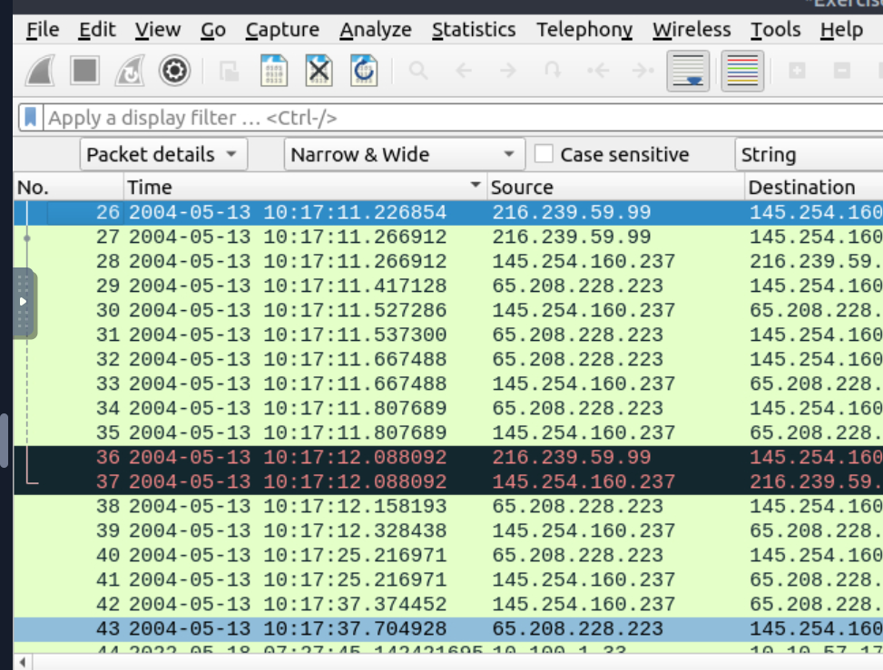
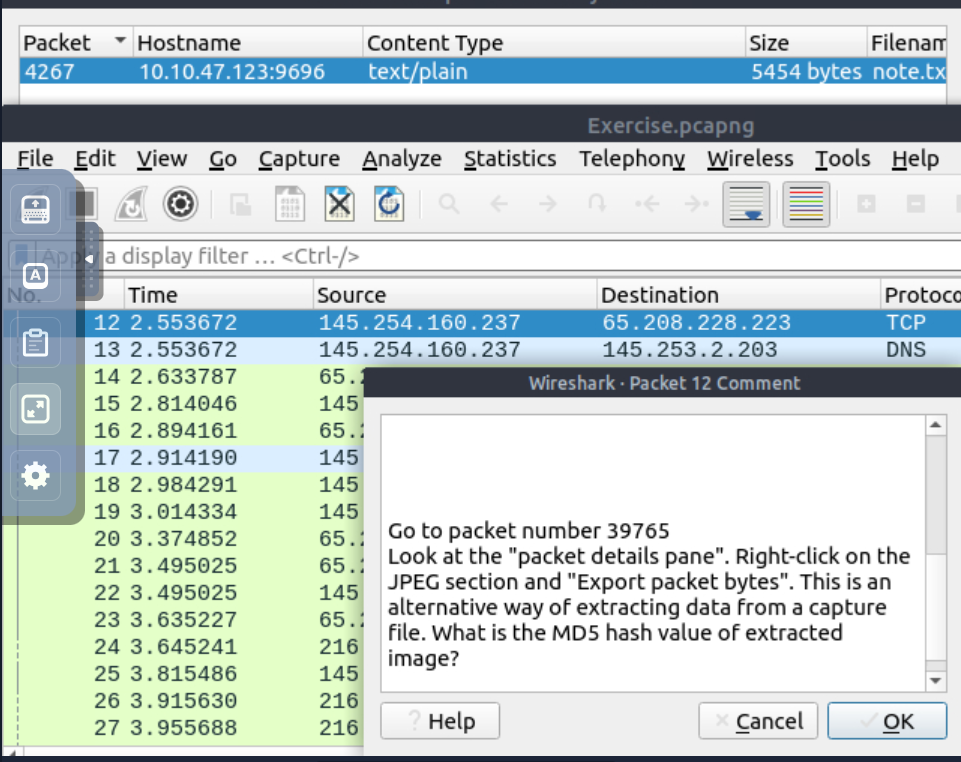
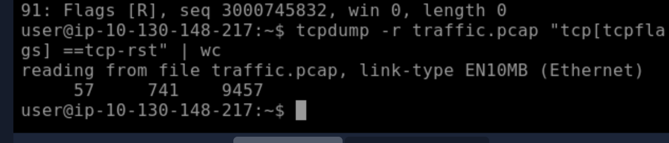
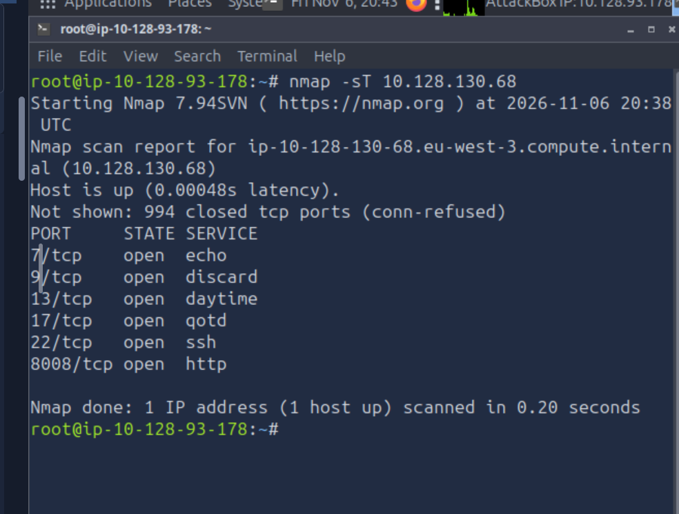

# Networking Fundamentals

**Platform:** TryHackMe – Cyber Security 101  
**Module:** Networking  
**Status:** Completed

## Overview

Completed hands-on networking exercises covering network communication, the OSI and TCP/IP models, IP addressing, routing, common network protocols and secure communications.

The module also introduced practical network analysis using Wireshark, tcpdump and Nmap to inspect packet captures, filter network traffic and identify open ports and services.

## Technical Skills Practised

| Area | Concepts / Tools | Practical Application |
|---|---|---|
| Networking Fundamentals | OSI, TCP/IP, IPv4, subnetting, TCP, UDP | Understanding network communication, addressing and routing |
| Networking Essentials | NAT, ARP, DHCP, ICMP, ping, traceroute | Understanding network connectivity and troubleshooting |
| Network Protocols | WHOIS, DNS, HTTP, FTP, SMTP, POP3, IMAP | Exploring network services, ports and data exchange |
| Secure Communications | SSL/TLS, HTTPS, SSH, VPN | Understanding encryption and secure network connections |
| Packet Analysis | Wireshark, tcpdump | Inspecting PCAP files, filtering packets and extracting data |
| Network Scanning | Nmap | Identifying open TCP ports and associated services |

## Practical Exercises

### 1. Wireshark – Packet Analysis

**Objective:** Analyse packet captures and investigate information contained within network traffic.

I explored the Wireshark interface, including packet navigation, packet details and display filters.

During a practical challenge, I investigated packet comments to locate additional instructions, navigated to a specific packet and explored extracting data from the capture. I also used `md5sum` to calculate the MD5 hash of an extracted file.

**Evidence:**





**Security Relevance:** Packet analysis supports network troubleshooting, traffic investigation and identifying suspicious communication during security monitoring.

### 2. tcpdump – Network Traffic Filtering

**Objective:** Examine PCAP files and filter network traffic using command-line tools.

I practised reading captured traffic, applying packet filters and examining TCP flags using tcpdump.

One exercise involved filtering packets based on the TCP reset (RST) flag.

```bash
tcpdump -r traffic.pcap "tcp[tcpflags] == tcp-rst" | wc
```

The command reads the capture file, filters packets matching the TCP RST flag condition and passes the output to `wc` to count the resulting lines, words and bytes.

**Evidence:**



**Security Relevance:** tcpdump provides a practical way to inspect network traffic directly from Linux systems, particularly when investigating connectivity issues or reviewing captured traffic without a graphical interface.

### 3. Nmap – Network Scanning

**Objective:** Identify open TCP ports and associated services on an authorised lab target.

I performed a TCP connect scan using Nmap:

```bash
nmap -sT 10.128.130.68
```

**Scan Results:**

| Port | Identified Service |
|---|---|
| 7/tcp | echo |
| 9/tcp | discard |
| 13/tcp | daytime |
| 17/tcp | qotd |
| 22/tcp | ssh |
| 8008/tcp | http |

The scan identified six open TCP ports, while 994 other scanned ports were reported as closed. The service names were identified from their common port assignments rather than confirmed through version detection.

**Evidence:**



**Security Relevance:** Nmap supports network discovery and security assessments by identifying exposed ports and potential services that may require further investigation.

## Key Takeaways

Completing this module strengthened my understanding of how network communication works and how networking tools can support security investigations.

I particularly enjoyed the practical exercises involving Wireshark, tcpdump and Nmap because they allowed me to move beyond networking theory and work directly with packet captures and scan results.

These skills provide a foundation for further development in network troubleshooting, security monitoring, vulnerability assessment and SOC operations.

---

**Note:** All practical exercises were completed within authorised TryHackMe training environments for educational purposes.
