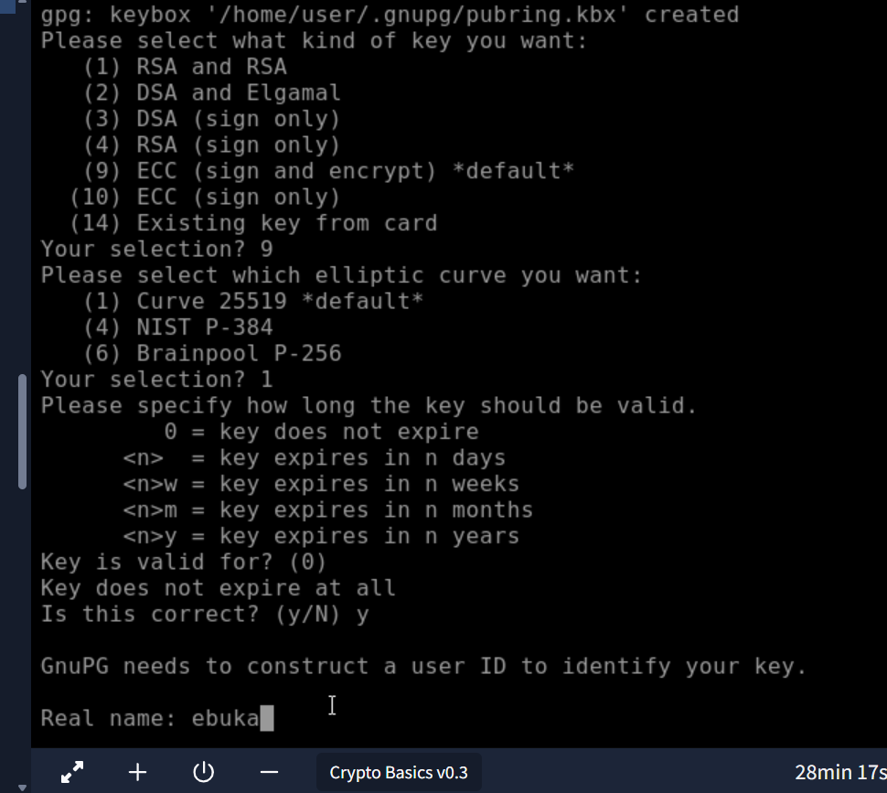
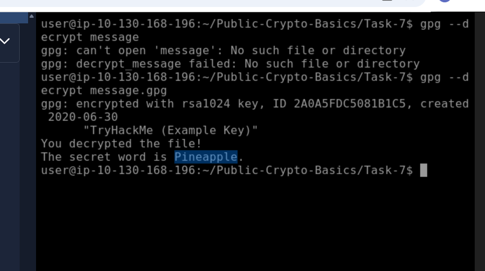
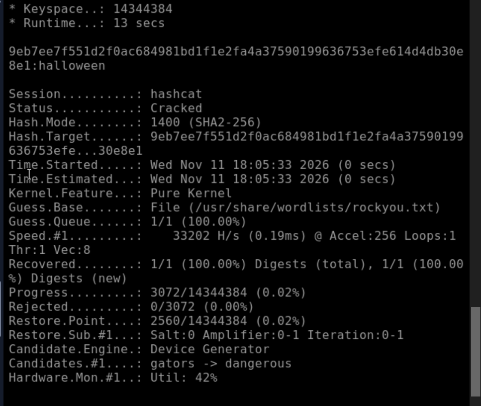
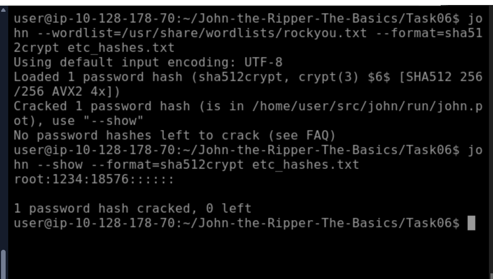
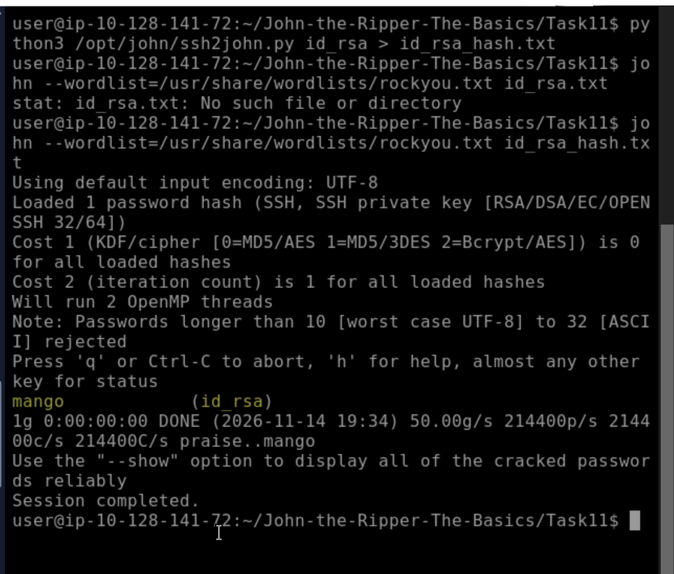

# Cryptography

**Platform:** TryHackMe – Cyber Security 101  
**Module:** Cryptography  
**Status:** Completed  

## Overview

Completed hands-on cryptography exercises covering encryption, hashing, public key cryptography, digital certificates and password security.

This module strengthened my understanding of how cryptography protects sensitive information and supports confidentiality, integrity and authenticity in modern systems.

I also explored data protection requirements, including GDPR, the Data Protection Act and PCI DSS, and how cryptographic controls help organisations protect sensitive information.

## Technical Skills Practised

| Area | Concepts / Tools | Practical Application |
|---|---|---|
| Cryptography Fundamentals | Symmetric and asymmetric encryption | Understanding encryption and decryption |
| Encryption Algorithms | DES, AES, RSA, ECC | Exploring cryptographic algorithms and their applications |
| Public Key Cryptography | Public/private keys, digital certificates | Understanding secure communication and authentication |
| GPG | GNU Privacy Guard | Generating keys, importing keys and decrypting files |
| Hashing | MD5, SHA-256, hash collisions | Understanding hashing and data integrity |
| Password Security | Password hashing, salts, secure storage | Identifying insecure password storage practices |
| Hashcat | SHA-256, RockYou wordlist | Testing password hash strength |
| John the Ripper | SHA-512 crypt, SSH private keys | Auditing password hashes and SSH key passphrases |

## Practical Exercises

### 1. GPG – Public Key Cryptography

**Objective:** Understand public key cryptography and practise working with encrypted files.

I explored symmetric and asymmetric encryption and how public and private keys are used to protect information.

During the practical exercise, I used GPG to generate a cryptographic key pair using ECC and Curve25519.

I also imported a provided TryHackMe key and used it to decrypt an encrypted message.

```bash
gpg --import tryhackme.key
gpg --decrypt message.gpg
```

**Result:** Successfully imported the provided key and decrypted the encrypted file.

**Evidence:**





**Security Relevance:** Public key cryptography supports secure communication, digital signatures and authentication. GPG provided practical experience working with cryptographic keys and encrypted information.

### 2. Hashcat – Password Hash Recovery

**Objective:** Understand how password hashes can be tested against candidate passwords.

I learnt how hashing works, why it differs from encryption and how weak passwords can still be recovered through password guessing attacks.

During the practical exercise, I used Hashcat with the RockYou wordlist to test a SHA-256 password hash.

**Result:** Hashcat successfully recovered the password associated with the provided hash.

**Evidence:**



**Security Relevance:** This exercise demonstrated why password strength and secure password storage are important. Fast hashing algorithms such as SHA-256 alone are unsuitable for password storage because they allow attackers to test large numbers of candidate passwords efficiently.

### 3. John the Ripper – Linux Password Hashes

**Objective:** Practise password auditing using John the Ripper.

I explored how John the Ripper can be used to test password hashes and identify weak credentials.

During the exercise, I worked with a Linux SHA-512 crypt password hash and used a wordlist to recover the password.

```bash
john --wordlist=/usr/share/wordlists/rockyou.txt --format=sha512crypt etc_hashes.txt
```

I then used the following command to display the recovered result:

```bash
john --show --format=sha512crypt etc_hashes.txt
```

**Result:** Successfully recovered the password from the provided lab hash.

**Evidence:**



**Security Relevance:** Password auditing helps identify weak credentials and reinforces the importance of strong passwords, secure hashing and appropriate authentication controls.

### 4. John the Ripper – SSH Private Key Passphrase

**Objective:** Understand how password auditing tools can test the protection of SSH private keys.

I completed another practical exercise involving an SSH private key protected by a passphrase.

I used `ssh2john.py` to convert the private key into a format John the Ripper could process.

```bash
python3 /opt/john/ssh2john.py id_rsa > id_rsa_hash.txt
```

I then tested the extracted hash against the RockYou wordlist.

```bash
john --wordlist=/usr/share/wordlists/rockyou.txt id_rsa_hash.txt
```

**Result:** John the Ripper successfully identified the passphrase protecting the provided SSH private key.

**Evidence:**



**Security Relevance:** SSH private keys are widely used for secure remote authentication. This exercise demonstrated why private keys should be protected with strong passphrases and appropriate access permissions.

## Security Relevance

This module helped me understand how cryptography supports information security and why organisations must implement cryptographic controls correctly.

I also learnt about common insecure password storage practices, including:

- Storing passwords in plaintext.
- Using outdated or unsuitable encryption methods for password storage.
- Using weak or unsuitable hashing algorithms without appropriate password protection mechanisms.

The practical exercises demonstrated how password auditing tools can identify weak credentials and why secure password storage, strong authentication and appropriate cryptographic controls are important.

## Key Takeaways

Completing this module strengthened my understanding of encryption, hashing, public key cryptography and password security.

I particularly enjoyed the practical exercises involving GPG, Hashcat and John the Ripper because they allowed me to apply cryptographic concepts rather than only studying the theory.

The password recovery challenges also encouraged me to think through problems, troubleshoot commands and understand how different tools work.

These skills provide a foundation for further development in cybersecurity, particularly security assessments, authentication security and incident investigations.

---

**Note:** All practical exercises were completed within authorised TryHackMe training environments for educational purposes. Challenge answers and recovered credentials have been excluded from the documentation.

